# DataLens

DataLens is a local tool that looks at a tabular dataset *before* you train anything on it. You give it a CSV, it tells you what is wrong with the data (missing values, duplicates, outliers, leakage between train and test), shows you the evidence, and then prepares a clean train/test split you can export.

I built it around network intrusion detection, using the **CIC-IDS2017** dataset (2.8 million flows) as the main test case, but it works on any CSV. Everything runs on your own machine. Your files are never modified and nothing is uploaded anywhere.

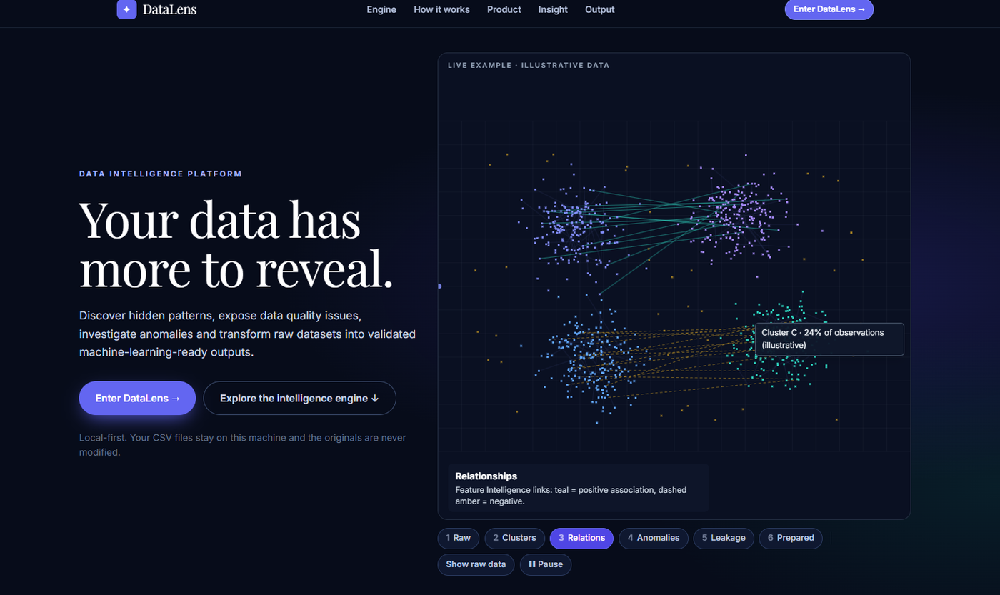


## Contents

1. [What it does](#what-it-does)
2. [Tech stack](#tech-stack)
3. [How it works](#how-it-works)
4. [The app on CIC-IDS2017](#the-app-on-cic-ids2017)
5. [Project layout](#project-layout)
6. [Install and run](#install-and-run)
7. [Using it](#using-it)
8. [Exports](#exports)
9. [API](#api)
10. [Tests](#tests)
11. [Known limitations](#known-limitations)
12. [Not built yet](#not-built-yet)
13. [Dataset and citation](#dataset-and-citation)

## What it does

| Area | What you get | Page in the app |
|---|---|---|
| Profiling | Rows, columns, data types, missing and ±infinite values, exact duplicates (global, within a file, across files), conflicting labels, constant and ID-like columns, class distribution. Read in chunks so memory stays bounded. | Overview |
| Investigation | Every finding comes with a plain explanation and a recommended action. Histograms, box plots, IQR outliers, rare-class and imbalance warnings. | Investigate |
| Feature Intelligence | Pearson and Spearman correlation heatmap (clustered so related columns sit together), correlated pairs, redundancy groups, feature-to-target association (mutual information, Cramér's V), VIF for multicollinearity. | Feature Intelligence |
| Anomaly Analysis | Isolation Forest, Local Outlier Factor, IQR and DBSCAN. Score distribution, PCA projection, a table of flagged rows with row IDs and "why flagged". Rows are never removed. | Anomaly Analysis |
| Leakage Intelligence | Findings marked *confirmed*, *potential* or *not assessed*, each with its evidence: exact train/test overlap, near-duplicates, duplicate exposure, ID-like and suspiciously predictive columns, group/time/preprocessing checks. | Leakage Intelligence |
| Dataset Health | A 0–100 score over six dimensions with a published formula, plus a separate ML-readiness verdict. Serious leakage caps the result. | Dataset Health |
| Recommendations | Suggestions derived from the findings. Accept, reject or customise each, then apply them to the Prepare form. | Recommendations |
| Preparation | Target column, sampling, test split, seed, duplicate policy, imputation, encoding, scaling, feature selection. All fitting uses training rows only. | Prepare |
| Validation | Before/after comparison, a check for missing/infinite values in the output, per-class train/test coverage, train/test overlap, run warnings. | Prepare, Exports |
| Process Map | A dark flow diagram of the whole workflow. Node colours come from the real state of your dataset and runs. | Process Map |
| Reproducibility | Same dataset + same options + same seed gives byte-identical exports. | – |

## Tech stack

| Layer | Technology | Used for |
|---|---|---|
| Backend | Python 3.11+, FastAPI, Uvicorn | REST API, background job runner |
| Data | pandas, NumPy, PyArrow | Chunked CSV reading, transformations |
| Statistics / ML | scikit-learn, SciPy | Isolation Forest, LOF, DBSCAN, PCA, mutual information, scaling, imputation, encoding, hierarchical clustering |
| Storage | JSON files, SQLite (temporary) | Workspace under `data/workspace/`; SQLite only for duplicate tracking during profiling |
| Frontend | React 18, Vite 5, Tailwind CSS 3 | Landing page and workspace |
| Charts | Hand-written SVG and canvas | Heatmap, histograms, scatter, radar, process map. No chart library. |
| Fonts | Inter, Playfair Display (via `@fontsource`) | Bundled, so no external requests |
| Config | YAML | `config/config.yaml` |
| Testing | pytest, Playwright | 235 backend tests, browser end-to-end workflow |

## How it works

### The workflow

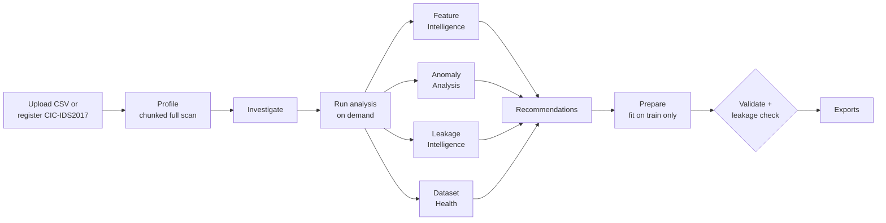

Profiling starts by itself after an upload. The analysis step does not: you run it when you want it. Leakage results that need a train/test split (exact overlap, near-duplicates) appear after you prepare a dataset.

### The system

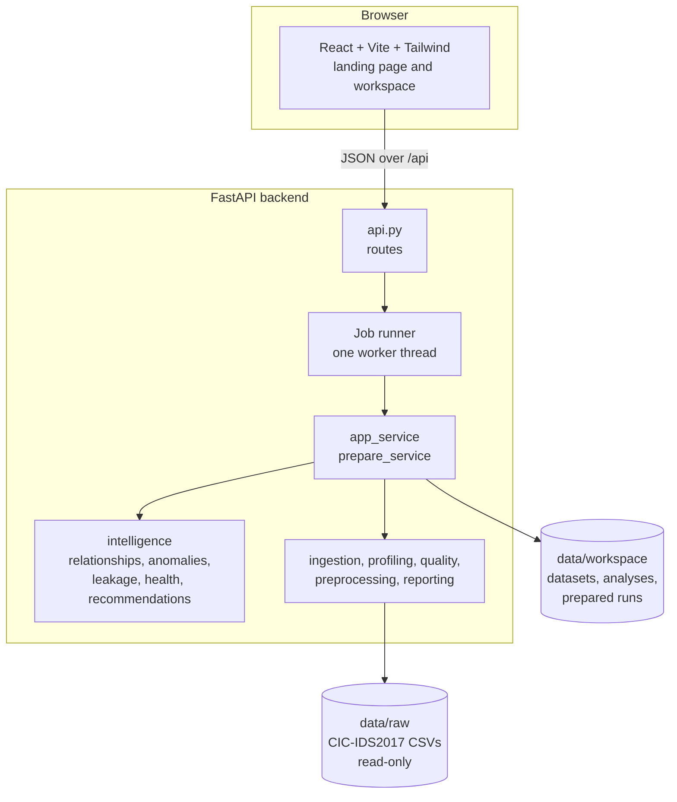

Long tasks (profile, analyse, anomaly detection, prepare) run as background jobs. The browser polls the job and shows progress. Only one job runs at a time.

### How the health score is built

Six dimensions are scored 0–100: completeness, validity, consistency, uniqueness, distribution and leakage. Five carry 15% weight and leakage carries 25%. If a confirmed leakage finding exists, the overall score is capped, so a dataset that is complete but leaky cannot look healthy. The page shows every factor behind each number.

## The app on CIC-IDS2017

These screenshots are from my own runs of the web app on the full **CIC-IDS2017** dataset: 2,830,743 flows and 79 columns, registered from local files (read-only). Analyses use a seeded sample of up to 50,000 rows. The preparation run used a 10% sample (283,074 rows) with a 20% test split.

### 1. Investigate: what the data looks like

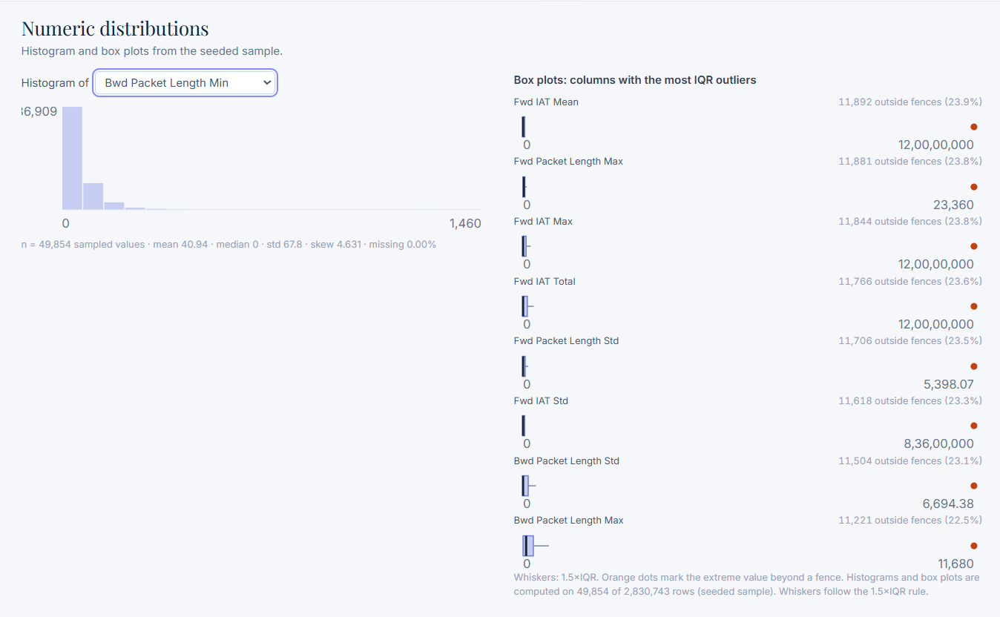

Histogram and box plots for numeric columns, computed on 49,854 sampled values out of 2,830,743 rows. The selected column (`Bwd Packet Length Min`) is heavily right-skewed (skew 4.6, median 0, mean about 41). The box plots on the right rank the columns with the most IQR outliers. `Fwd IAT Mean` has about 24% of values outside the fences. Network timing and size features are extremely heavy-tailed, which is why robust scaling is the default.

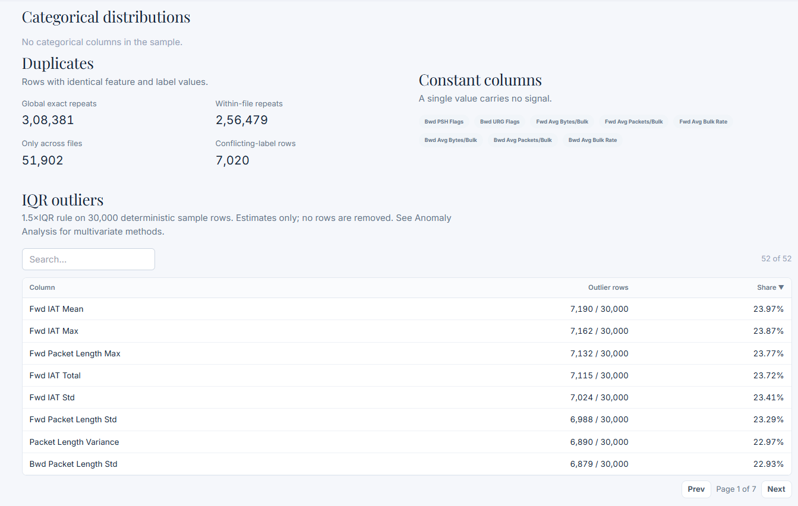

- **Duplicates:** 308,381 rows are exact repeats of another row (about 10.9% of the data). 256,479 repeat within the same file and 51,902 only across files.
- **Conflicting labels:** 7,020 rows have identical features but different labels. No model can get these right, so they cap the accuracy you can honestly claim.
- **Constant columns:** 8 columns hold a single value (for example `Bwd PSH Flags`, `Bwd URG Flags` and the bulk-rate columns). They carry no signal.
- **IQR outliers:** a sortable table over 52 numeric columns, based on a 30,000-row deterministic sample. These are estimates, and no rows are removed.

### 2. Feature Intelligence: how columns relate

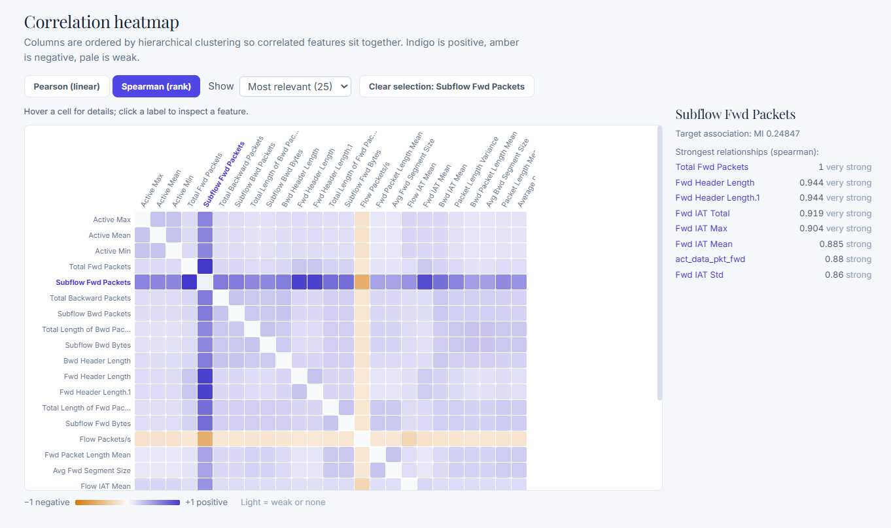

Spearman heatmap of the 25 most relevant features, ordered by hierarchical clustering so related columns sit next to each other. Indigo is positive correlation and amber is negative. Clicking a label opens the inspector on the right. Here `Subflow Fwd Packets` is selected: it is almost a copy of `Total Fwd Packets` (1.0) and strongly tied to `Fwd Header Length` (0.94) and several `Fwd IAT` columns, with a mutual-information score of 0.25 against the label. Large blocks like this mean many columns say the same thing, which matters for linear models and for feature importance later.

### 3. Anomaly Analysis: unusual flows

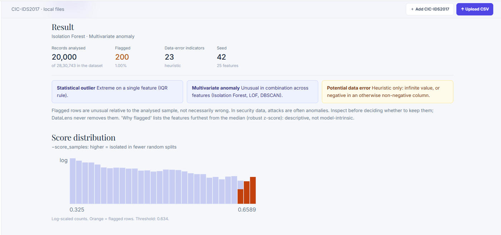

Isolation Forest on 20,000 rows and 25 features, seed 42. The score distribution is log-scaled and the orange bars are the flagged rows above the threshold (0.634). One thing to read carefully: I set the expected anomaly share to 1.0%, so 200 flagged rows (1.00%) is the setting, not a discovery. What is useful is *which* rows were flagged and why. The "data-error indicators" box (23 here) is a separate heuristic for impossible values such as infinities or negatives in otherwise non-negative columns.

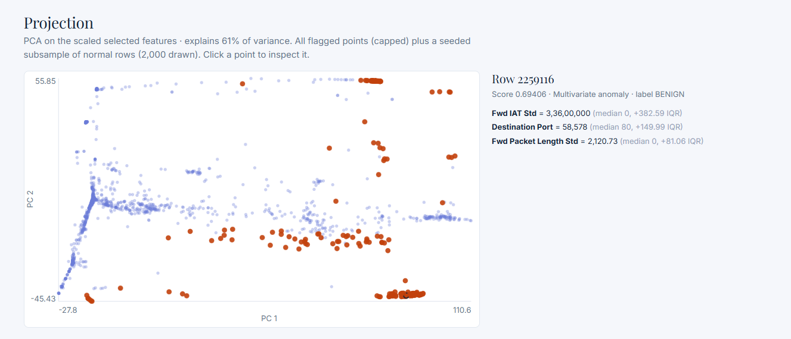

PCA projection (61% of variance explained). Orange points are flagged and blue are a seeded subsample of normal rows. Clicking a point shows why it was flagged. Row 2259116, for example, is labelled BENIGN but has a `Fwd IAT Std` about 383 IQRs above the median. In security data, attacks are often anomalies, but so are odd benign flows, so the page leaves the decision to the person looking at it.

### 4. Prepare: leakage-safe preprocessing

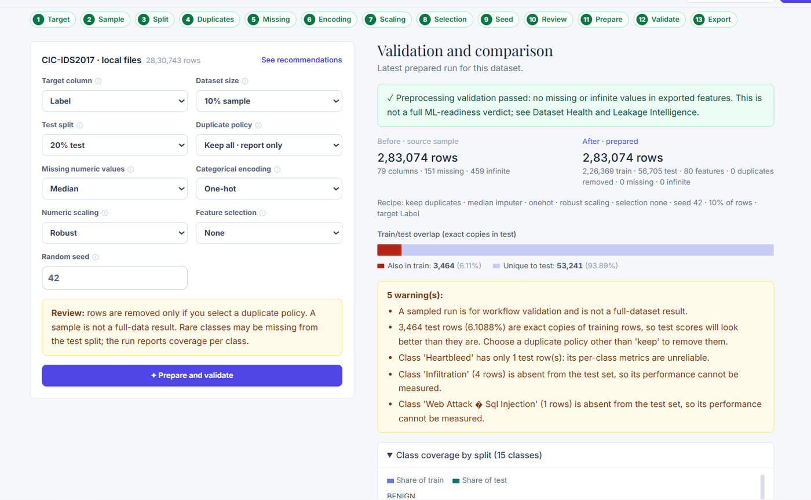

The 13-step strip at the top follows the flow from target selection to export. This run used the Label column as target, a 10% sample, median imputation, one-hot encoding, robust scaling, no feature selection and seed 42.

| | Before (source sample) | After (prepared) |
|---|---|---|
| Rows | 283,074 | 226,369 train + 56,705 test |
| Columns / features | 79 columns | 80 features |
| Missing cells | 151 | 0 |
| Infinite cells | 459 | 0 |

Validation passed, meaning no missing or infinite values remain in the exported features. The page says clearly that this is *not* an ML-readiness verdict. The run also raised five warnings, for example that 3,464 test rows are exact copies of training rows, and that several rare classes (`Heartbleed`, `Infiltration`, `Web Attack – Sql Injection`) have almost no test rows, so per-class metrics for them would be unreliable.

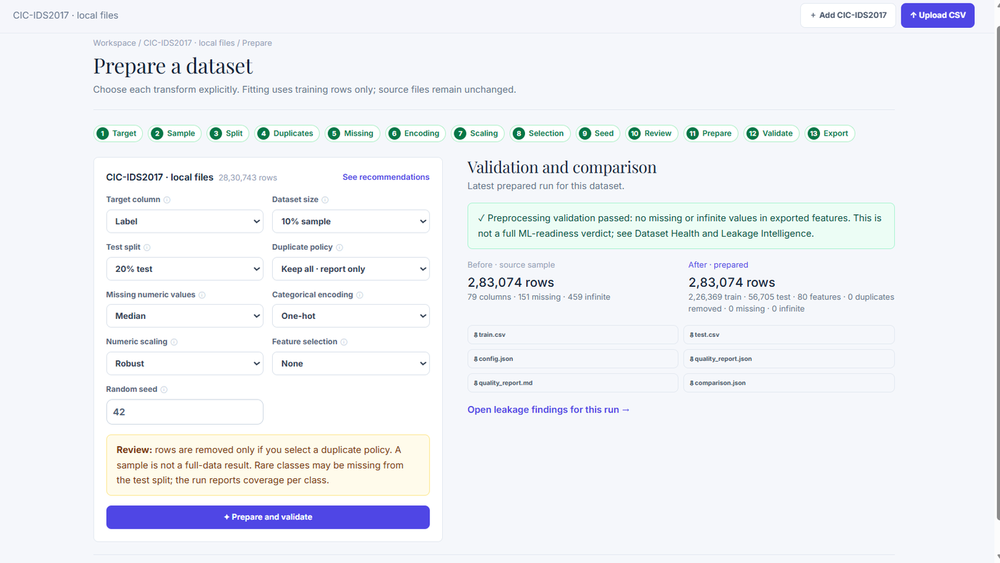

Every run keeps its own folder of files that can be downloaded from the app (see [Exports](#exports)).

### 5. Leakage Intelligence: can the test set be trusted?

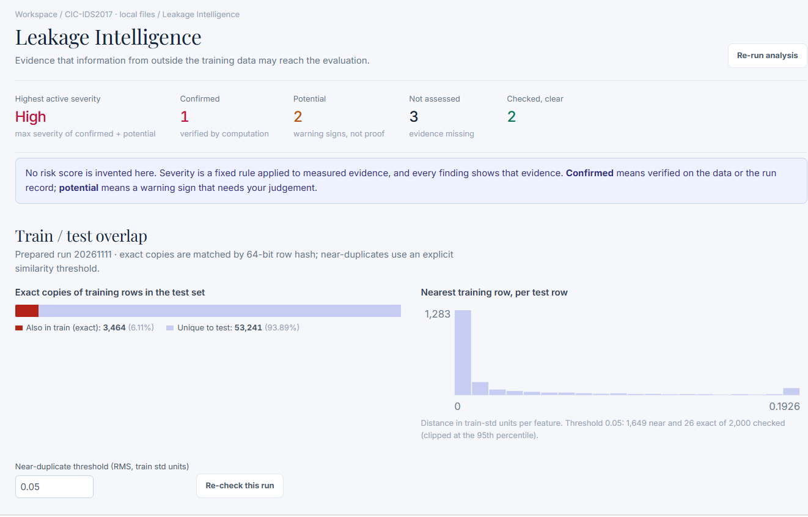

After preparation DataLens compares the splits. **3,464 of 56,705 test rows (6.11%) are exact copies of training rows**, matched by a 64-bit hash over all columns. The histogram shows the distance from each test row to its nearest training row: most are extremely close. 

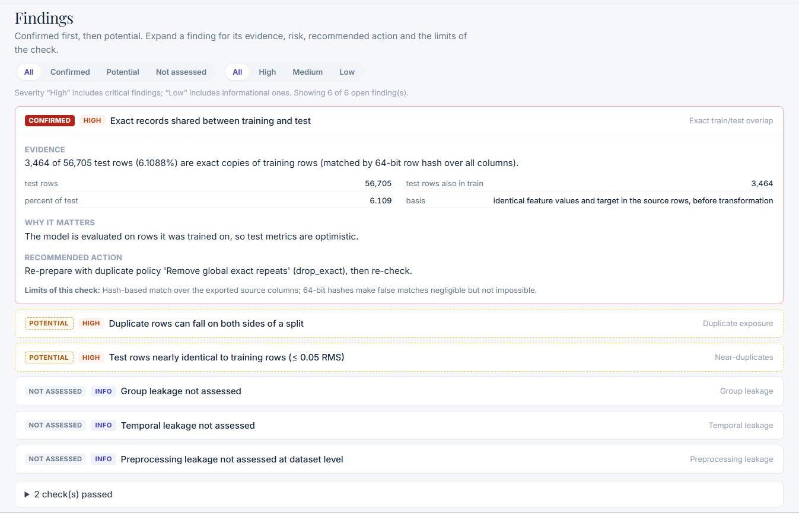

Findings are sorted by status. The one *confirmed* finding is the exact overlap, shown open with its evidence, why it matters and the recommended fix (re-prepare with the `drop_exact` duplicate policy and check again). Two are *potential* (duplicate exposure and near-duplicates). Group, temporal and preprocessing leakage are marked *not assessed* because the data has no group or time column to test, and DataLens will not guess. The two filters let you narrow by status and by severity.

### 6. Dataset Health: the overall verdict

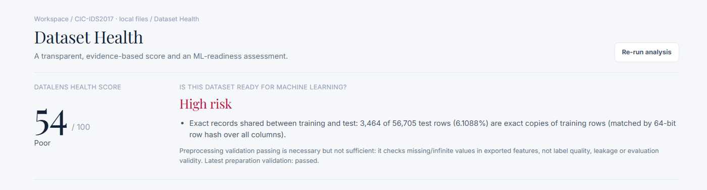

**54 / 100, High risk.** Preprocessing succeeded, but the confirmed train/test overlap is why the verdict is not better. A complete, clean-looking dataset can still be risky.

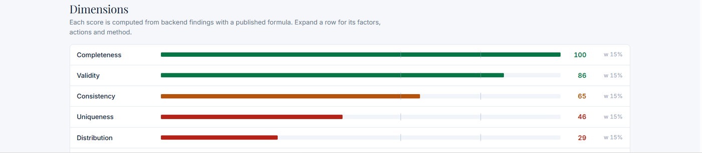

Scores per dimension: completeness 100, validity 86, consistency 65, uniqueness 46 and distribution 29. Leakage (20, not visible in this crop) is the lowest. Each row expands to show the exact factors and penalties behind the number.

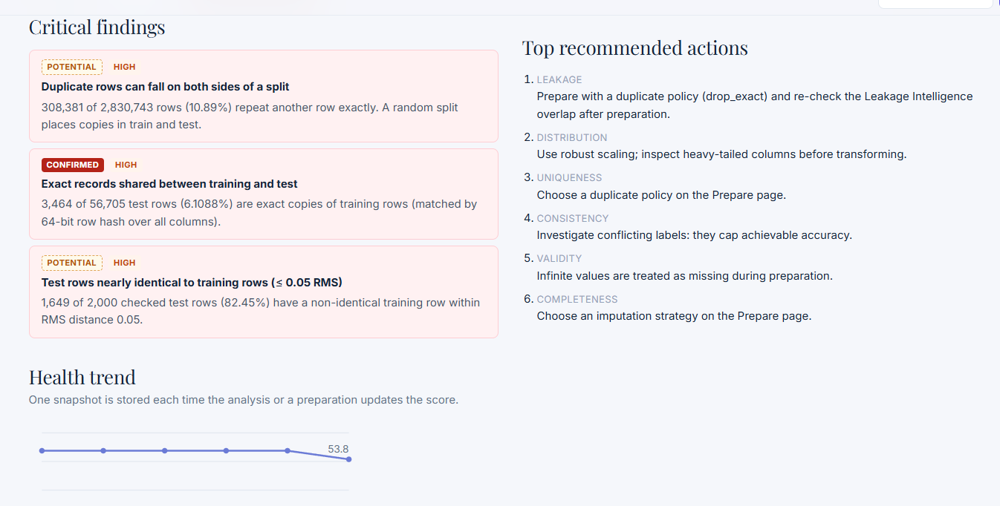

Critical findings are listed with their evidence next to a ranked to-do list: drop exact duplicates and re-check the overlap, use robust scaling for the heavy-tailed columns, investigate conflicting labels, and choose an imputation strategy. The trend line stores one snapshot each time the score is recomputed.

### Process map and landing page

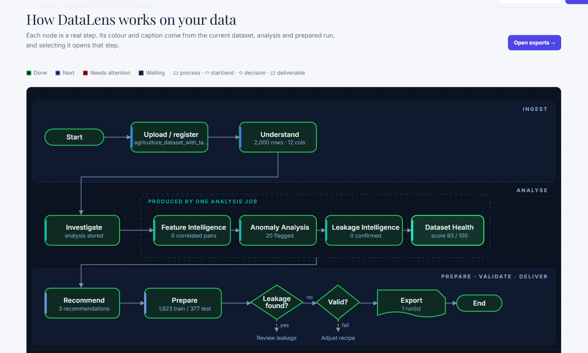

The process map shows the workflow as a diagram. Each node is coloured from real state (done, next, needs attention, waiting), and clicking one opens that step. *This screenshot is from a small 2,000-row demo dataset, not CIC-IDS2017.* The landing page at the top of this README opens the same workspace.

## Project layout

```
DataLens/
├── config/config.yaml          settings (paths, seeds, thresholds)
├── data/
│   ├── README.md               how to get CIC-IDS2017
│   ├── raw/                    put the CIC-IDS2017 CSVs here
│   └── workspace/              uploads, analyses, prepared runs
├── docs/
│   ├── ARCHITECTURE.md         design and extension points
│   ├── FEATURES.md             methods and limits of every feature
│   └── screenshots/            images used in this README
├── scripts/                    command-line entry points (verify, profile, investigate, prepare)
├── src/datalens/
│   ├── api.py                  FastAPI routes and job runner
│   ├── app_service.py          dataset store, chunked profiling
│   ├── prepare_service.py      preparation runs and exports
│   ├── ingestion/              file verification and loading
│   ├── profiling/              profiler and dataset investigation
│   ├── quality/                quality assessment
│   ├── preprocessing/          splitting, duplicates, labels, train-only fitting
│   ├── features/               feature analysis and selection
│   ├── evaluation/             imbalance reporting
│   ├── reporting/              markdown and JSON reports
│   └── intelligence/           sampling, distributions, relationships,
│                               anomalies, leakage, health, recommendations
├── tests/                      pytest suite and Playwright end-to-end script
└── web/
    └── src/
        ├── App.jsx             app shell, state, job polling, routing
        ├── pages/              workspace pages
        │   └── Landing/        landing page sections
        └── components/         charts, navigation, feedback, landing visuals
```

## Install and run

You need Python 3.11+ and Node.js 18+.

```powershell
python -m venv .venv
.venv\Scripts\Activate.ps1          # Linux/macOS: source .venv/bin/activate
pip install -r requirements.txt
pip install -e .
```

Backend (terminal 1, from the repo root):

```powershell
python -m uvicorn datalens.api:app --host 127.0.0.1 --port 8000
```

Frontend (terminal 2):

```powershell
cd web
npm install
npm run dev          # http://localhost:5173, proxies /api to port 8000
npm run build        # production build into web/dist
```

Set `DATALENS_WORKSPACE` to move the workspace folder somewhere else.

## Using it

1. Open the app and press **Enter DataLens**. The landing page is at `#/` and the workspace at `#/app`.
2. **Upload a CSV**, or press **Add CIC-IDS2017** to register the files in `data/raw/` (they stay read-only). Uploads are validated: empty, binary, header-only and unparsable files are rejected with a clear message. Profiling starts automatically.
3. Read **Overview** and **Investigate**. Run the analysis when you want the deeper pages.
4. Check **Feature Intelligence**, **Anomaly Analysis**, **Leakage Intelligence**, **Dataset Health** and **Recommendations**.
5. Go to **Prepare**, set options (or apply accepted recommendations), then **Prepare and validate**.
6. Download the files from **Exports**. Leakage Intelligence and Dataset Health update with the new run.

The original command-line scripts from the first phases are still in the repo:

```bash
python scripts/verify_dataset.py                          # file-level checks
python scripts/profile_dataset.py --sample-fraction 0.1   # profile and quality report
python scripts/investigate_dataset.py                     # streaming investigation
python scripts/prepare_dataset.py --sample-fraction 0.1   # sampled preparation run
```

## Exports

Each prepared run writes these files:

| File | Content |
|---|---|
| `train.csv`, `test.csv` | transformed features plus the untouched target |
| `config.json` | exact options, seed, fitted parameters, class coverage, fit scope |
| `quality_report.json`, `quality_report.md` | findings, recommendations, validation, warnings |
| `comparison.json` | before/after figures |
| `leakage_report.json` | leakage findings for the run (newer runs) |

## API

| Method | Route | Purpose |
|---|---|---|
| GET | `/api/health` | service check |
| GET, POST | `/api/datasets` | list / register datasets |
| POST | `/api/datasets/upload?filename=` | upload a CSV |
| POST | `/api/datasets/import-cicids` | register local CIC-IDS2017 files |
| GET, DELETE | `/api/datasets/{id}` | read / remove a dataset |
| POST | `/api/datasets/{id}/profile` | start profiling |
| POST | `/api/datasets/{id}/analyze` | start the full analysis |
| GET | `/api/datasets/{id}/analysis` | read stored analysis |
| POST | `/api/datasets/{id}/anomalies` | run one anomaly detector |
| POST | `/api/datasets/{id}/prepare` | start a preparation run |
| GET | `/api/jobs/{id}` | job status and progress |
| GET | `/api/preparations` | list runs |
| GET, POST | `/api/preparations/{id}/leakage` | read / re-run the leakage check |
| GET | `/api/preparations/{id}/files/{name}` | download an export |
| DELETE | `/api/preparations/{id}` | delete a run |

## Tests

```powershell
python -m pytest -q
```

This runs 235 backend tests: ingestion, profiling, splitting, train-only fitting, imbalance, API behaviour and the intelligence modules (including a regression test for a Windows file-locking bug). The browser workflow check needs Playwright and both servers running:

```bash
NODE_PATH=$(npm root -g) node tests/e2e/workflow.cjs <csv> <scratch-dir>
```

It covers the landing page, upload, all workspace pages, filters, downloads, responsive widths and browser back/forward.

## Known limitations

- One background job at a time (single worker).
- Analyses run on a seeded sample (up to 50,000 rows). Exact counts come from the full-data profile, so anomaly and leakage numbers are sample-based estimates.
- The train/test split is random, not temporal or grouped. For intrusion data, flows from the same session can land on both sides. This is exactly what the leakage pages warn about.
- Train/test assignment is seeded per class and only approximately stratified, so very rare classes can be missing from a split. The run reports this.
- Scaler, imputer and encoder are fitted on at most 500,000 training rows.
- One-hot encoding groups categories under 1% of training rows into an "infrequent" column.
- DataLens cannot yet drop columns, resample, weight classes or split by group/time. Recommendations that need this show up as manual steps.
- One class label in CIC-IDS2017 shows as `Web Attack � Sql Injection` in the app. The source files use a non-UTF-8 dash character and it is displayed as a replacement character. It does not affect the results, but the label is not cleaned.
- The full 2.8M-row dataset has been profiled through the UI. Timing and memory were measured on 1M-row synthetic data in a Linux container, not on CIC-IDS2017.
- The "real" screenshots on the landing page use a small synthetic demo dataset. Figures in the landing page's illustrative panels are labelled as illustrative and are not results.


## Dataset and citation

CIC-IDS2017 is not included in this repository. See [`data/README.md`](data/README.md) for download steps and terms. If you use it, cite:

> I. Sharafaldin, A. H. Lashkari, A. A. Ghorbani, "Toward Generating a New Intrusion Detection Dataset and Intrusion Traffic Characterization", ICISSP 2018.

## More documentation

- [`docs/FEATURES.md`](docs/FEATURES.md): methods and limits of each feature
- [`docs/ARCHITECTURE.md`](docs/ARCHITECTURE.md): design and extension points
- [`CHANGELOG.md`](CHANGELOG.md): what changed in each version
- [`PROGRESS.md`](PROGRESS.md): phase-by-phase status

