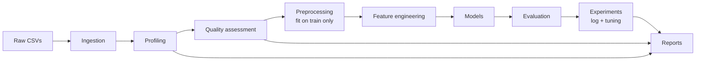

# DataLens

**From Raw Data to Reliable Machine Learning.**

An experimental framework for dataset intelligence, data quality assessment and predictive modeling, applied to network intrusion detection on CIC-IDS2017.

> **Status: Phases 1-3 implementation integrated; Phase 3 has not yet been locally tested or run on CIC-IDS2017.** Phase 1/2 reports are present locally. Phase 3 adds dataset investigation, leakage-aware preparation, and train-only preprocessing and analysis. No Phase 3 results are claimed here; see `PROGRESS.md`.

## Motivation

Real datasets are rarely ML-ready: missing values, duplicates, invalid values, imbalance and redundant features all distort model results. Intrusion-detection benchmarks add temporal dependence and collection artifacts that can inflate scores. DataLens makes those issues visible and measures how data-preparation choices change model behavior.

## Research questions

1. What data quality problems exist in the selected network traffic dataset?
2. How do preprocessing and feature engineering decisions affect model performance?
3. How do different classifiers perform on the same prepared dataset?
4. How does class imbalance affect accuracy, precision, recall and F1?
5. Can systematic hyperparameter optimization improve performance?
6. Which features contribute most to predictions?
7. How do computational requirements differ between models?

## Planned architecture



Implemented so far: configuration, ingestion (`verify`, `loader`), profiling, quality assessment, dataset investigation, train/test splitting, preprocessing, feature analysis, imbalance reporting, preparation summaries, and run metadata. Model training remains unimplemented.

## Setup

```bash
python -m venv .venv
source .venv/bin/activate        # Windows: .venv\Scripts\activate
pip install -r requirements.txt
pip install -e .
pytest
```

## Dataset

CIC-IDS2017 is **not** included. See [`data/README.md`](data/README.md) for download steps and citation/terms notes, then:

```bash
python scripts/verify_dataset.py                          # file-level checks
python scripts/profile_dataset.py                         # profile + quality report (full data)
python scripts/profile_dataset.py --sample-fraction 0.1   # development sample (recorded in outputs)
```

Outputs go to `reports/tables/` (`quality_report.md`, `quality_findings.csv`, `profile_columns.csv`, `profile_summary.json`). Every output records whether it came from the full dataset or a sample.

## Repository layout

See `src/datalens/` for modules, `config/config.yaml` for settings, `PROGRESS.md` for phase status.

## Limitations

Offline benchmark results will not demonstrate real-world production intrusion detection. Evaluation-validity limits will be documented as they are investigated.
## Phase 3 preparation

The Phase 3 scripts are available after installing the project dependencies:

```bash
python scripts/investigate_dataset.py                         # full dataset, streaming investigation
python scripts/prepare_dataset.py --sample-fraction 0.1      # explicitly sampled preparation run
```

Preparation reports are written below `reports/tables/phase3/`; investigation reports are written below `reports/tables/`. Sampling is explicit and recorded. The full-data preparation default can require substantial memory. Review `PROGRESS.md` for known evaluation concerns. These commands have not yet been run locally as part of this integration.

## Web application (v0.4.0)

A local FastAPI backend plus a React/Vite frontend implement the full workflow:
**Upload → Overview → Investigate → Prepare → Validate → Compare → Export.** No cloud, accounts or database; everything lives under `data/workspace/` (git-ignored). Source CSV files are never modified.

### Features
- **Dataset intelligence** (chunked, bounded memory): rows, columns, types, missing and ±infinite values, exact duplicates (global, within-file, across files), conflicting labels, constant and identifier-like columns, IQR outliers (on a deterministic sample), class distribution, rare-class and imbalance risks. Every finding has an explanation and a recommendation.
- **Preparation options**: target column, sampling fraction, test split, seed, duplicate policy (`keep`, `drop_within_file`, `drop_exact`), numeric imputation, one-hot/ordinal encoding, scaling (robust, standard, min-max, none), feature selection (none, variance, ANOVA F top-k). All fitting uses training rows only.
- **Validation and comparison**: exported features are checked for missing/infinite values; before/after row, feature, missing, infinite and duplicate figures; per-class train/test coverage; train/test exact-overlap; run warnings.
- **Reproducibility**: the same dataset, options and seed produce byte-identical exports.

### Dataset intelligence (v0.4.0)
Beyond profiling and preparation, a background **analysis** (Investigate → *Run analysis*) adds, on a seeded ≤50,000-row sample plus the full-data profile:
- **Feature Intelligence**: correlation heatmap (Pearson/Spearman), correlated pairs, redundancy groups, feature–target ranking (mutual information, Cramér's V), VIF.
- **Anomaly Analysis**: Isolation Forest, LOF, IQR, DBSCAN; scores, projection, flagged records with row ids. Nothing is removed.
- **Leakage Intelligence**: confirmed vs potential vs not-assessed findings with evidence (exact overlap, near-duplicates, identifier-like and suspicious columns, group/temporal/preprocessing checks).
- **Dataset Health**: transparent 0–100 score per dimension, overall score, and a separate ML-readiness verdict.
- **Recommendations**: accept / reject / customise, then apply to the Prepare form.

See [`docs/FEATURES.md`](docs/FEATURES.md) for methods and limits and [`docs/ARCHITECTURE.md`](docs/ARCHITECTURE.md) for the design and future extension points.

### Install and run

```powershell
python -m venv .venv
.venv\Scripts\Activate.ps1
pip install -r requirements.txt
pip install -e .
pip install fastapi uvicorn httpx   # if not already pulled in by requirements
```

Backend (terminal 1, from the repo root):
```powershell
python -m uvicorn datalens.api:app --host 127.0.0.1 --port 8000
```
Frontend (terminal 2):
```powershell
cd web
npm install        # fonts are bundled; no external requests
npm run dev        # http://localhost:5173 (proxies /api to 127.0.0.1:8000)
npm run build      # production build into web/dist
```
Set `DATALENS_WORKSPACE` to relocate the workspace folder.

### Usage
1. **Upload CSV** (or *Add CIC-IDS2017* to register files in `data/raw/`, read-only). Uploads are validated (binary, empty, header-only and unparsable files are rejected) and profiled automatically.
2. **Overview** and **Investigate**: read findings and recommendations; *Apply recipe* fills the Prepare form with the recommended choices.
3. **Prepare**: set options, *Prepare and validate*, watch progress.
4. **Validation / Exports**: review the comparison, warnings and class coverage, then download.

### Exports (per run)
| File | Content |
|---|---|
| `train.csv`, `test.csv` | transformed features plus the untouched target |
| `config.json` | exact options, seed, fitted parameters, class coverage |
| `quality_report.json` / `.md` | findings, recommendations, validation, warnings |
| `comparison.json` | before/after figures |

### API
`GET /api/health`, `GET|POST /api/datasets`, `POST /api/datasets/upload?filename=`, `POST /api/datasets/import-cicids`, `GET|DELETE /api/datasets/{id}`, `POST /api/datasets/{id}/profile`, `POST /api/datasets/{id}/prepare`, `POST /api/datasets/{id}/analyze`, `GET /api/datasets/{id}/analysis`, `POST /api/datasets/{id}/anomalies`, `GET /api/jobs/{id}`, `GET /api/preparations`, `GET|POST /api/preparations/{id}/leakage`, `DELETE /api/preparations/{id}`, `GET /api/preparations/{id}/files/{name}`.

### Limitations
- One background job at a time (single worker).
- Analyses run on a seeded sample (≤50,000 rows); exact counts come from the full profile. Anomaly and leakage results are sample-based estimates.
- DataLens cannot yet exclude columns, resample or weight classes, or split by group/time; recommendations that need this are shown as manual steps.
- Not implemented: ML experiment lab, experiment tracking, drift analysis, AI analyst, other file formats (see `docs/ARCHITECTURE.md`).
- Train/test assignment is seeded per-class Bernoulli, approximately (not exactly) stratified; rare classes can be missing from a split. The run reports this.
- Scaler, imputer and encoder are fitted on a train sample of at most 500k rows.
- One-hot encoding groups categories under 1% of training rows into an "infrequent" column.
- Outlier figures are estimates from a deterministic sample.
- The split is random, not temporal; for intrusion data, flows from one session can land in both splits.
- Not tested: Windows-specific runs and the full 2.8M-row CIC-IDS2017 set through the UI (measured on 1M synthetic rows only).

### Tests
```powershell
python -m pytest -q
```

Browser end-to-end check (needs Playwright, servers running): `NODE_PATH=$(npm root -g) node tests/e2e/workflow.cjs <csv> <scratch-dir>`.
