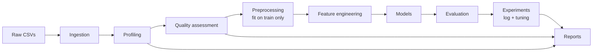

# DataLens

**From Raw Data to Reliable Machine Learning.**

An experimental framework for dataset intelligence, data quality assessment and predictive modeling, applied to network intrusion detection on CIC-IDS2017.

> **Status: Phases 1-3 implementation integrated; Phase 3 has not yet been locally tested or run on CIC-IDS2017.** Phase 1/2 reports are present locally. Phase 3 adds dataset investigation, leakage-aware preparation, and train-only preprocessing and analysis. No Phase 3 results are claimed here; see `PROGRESS.md`.

## Motivation

Real datasets are rarely ML-ready: missing values, duplicates, invalid values, imbalance and redundant features all distort model results. Intrusion-detection benchmarks add temporal dependence and collection artifacts that can inflate scores. DataLens makes those issues visible and measures how data-preparation choices change model behavior.

## Research questions

1. What data quality problems exist in the selected network traffic dataset?
2. How do preprocessing and feature engineering decisions affect model performance?
3. How do different classifiers perform on the same prepared dataset?
4. How does class imbalance affect accuracy, precision, recall and F1?
5. Can systematic hyperparameter optimization improve performance?
6. Which features contribute most to predictions?
7. How do computational requirements differ between models?

## Planned architecture



Implemented so far: configuration, ingestion (`verify`, `loader`), profiling, quality assessment, dataset investigation, train/test splitting, preprocessing, feature analysis, imbalance reporting, preparation summaries, and run metadata. Model training remains unimplemented.

## Setup

```bash
python -m venv .venv
source .venv/bin/activate        # Windows: .venv\Scripts\activate
pip install -r requirements.txt
pip install -e .
pytest
```

## Dataset

CIC-IDS2017 is **not** included. See [`data/README.md`](data/README.md) for download steps and citation/terms notes, then:

```bash
python scripts/verify_dataset.py                          # file-level checks
python scripts/profile_dataset.py                         # profile + quality report (full data)
python scripts/profile_dataset.py --sample-fraction 0.1   # development sample (recorded in outputs)
```

Outputs go to `reports/tables/` (`quality_report.md`, `quality_findings.csv`, `profile_columns.csv`, `profile_summary.json`). Every output records whether it came from the full dataset or a sample.

## Repository layout

See `src/datalens/` for modules, `config/config.yaml` for settings, `PROGRESS.md` for phase status.

## Limitations

Offline benchmark results will not demonstrate real-world production intrusion detection. Evaluation-validity limits will be documented as they are investigated.
## Phase 3 preparation

The Phase 3 scripts are available after installing the project dependencies:

```bash
python scripts/investigate_dataset.py                         # full dataset, streaming investigation
python scripts/prepare_dataset.py --sample-fraction 0.1      # explicitly sampled preparation run
```

Preparation reports are written below `reports/tables/phase3/`; investigation reports are written below `reports/tables/`. Sampling is explicit and recorded. The full-data preparation default can require substantial memory. Review `PROGRESS.md` for known evaluation concerns. These commands have not yet been run locally as part of this integration.
